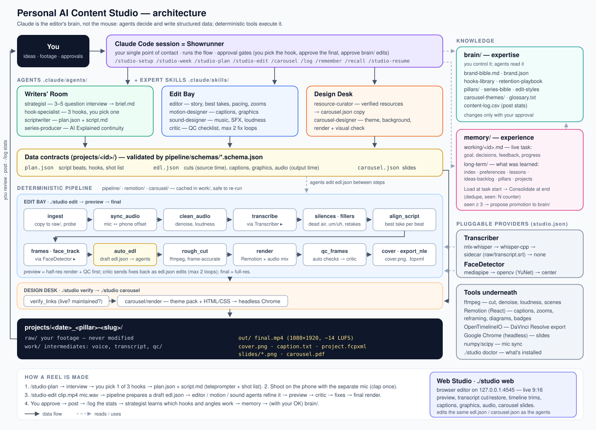

# Personal AI Content Studio

A content studio that lives in one folder on your Mac. Claude plans your content with you, edits your raw footage into finished vertical reels, and designs resource carousels. It remembers what you like and learns what performs.

**Claude is the editor's brain, not the mouse.** AI agents decide *what* to do and write it down as structured data (`plan.json`, `edl.json`, `carousel.json`). Ordinary deterministic tools (ffmpeg, Remotion, headless Chrome) turn that data into video and images. Nothing clicks through a GUI editor.

**New here? Read [INSTRUCTIONS.md](INSTRUCTIONS.md)** — step-by-step guides for planning the week, scripting a reel, editing raw footage into a reel, and making a resource carousel.



*(Also saved as [docs/architecture.png](docs/architecture.png).)*

---

## What it makes

| Pillar | You get | Command |
|---|---|---|
| **Build in Public** | 9:16 reels: jump cuts, punch-in zooms, bold word-pop captions, "Day N" badge | `/studio-plan`, `/studio-edit` |
| **AI Explained** | Numbered series reels: clean captions, animated box-and-arrow diagrams, series tag, intro sting | `/studio-plan`, `/studio-edit` |
| **Useful Resources** | Themed Instagram carousels (1080×1350 or 1080×1080) plus a LinkedIn PDF | `/carousel` |

Every reel comes with `final.mp4` (1080×1920, H.264/AAC, −14 LUFS), `cover.png`, `caption.txt` and `project.fcpxml`, which opens in DaVinci Resolve or Final Cut for hand tweaks.

---

## 1. Requirements

- A Mac with Apple Silicon (built on an M5, 24 GB, macOS 26)
- [Homebrew](https://brew.sh)
- Google Chrome (renders carousel slides)
- [Claude Code](https://claude.com/claude-code), for the agent flows

`scripts/setup.sh` installs everything else: ffmpeg, Node, uv, Python 3.12 and the Remotion packages.

## 2. Install

```bash
cd personal-studio
scripts/setup.sh                                  # core only: small, no ML models
scripts/setup.sh --with transcribe --with vision  # + Whisper transcription + OpenCV face tracking
```

The script ends by printing a dependency report. You can re-run the report any time:

```bash
./studio doctor
```

**Feature packs** are optional add-ons. The studio works without them and falls back gracefully:

| Pack | Adds | Without it |
|---|---|---|
| `--with transcribe` | Whisper (mlx-whisper, *no torch*) → word-level captions, filler and retake removal, script matching | Cuts dead air by silence only; captions off (or use a sidecar `.srt`, see below) |
| `--with vision` | OpenCV YuNet face tracking + smarter cover-frame picking | Centre crop |
| `--with face` | mediapipe face tracking | OpenCV / centre crop |

> **Slow or flaky network?** `setup.sh` retries failed downloads. For very large wheels, download them with `curl -C -` (which can resume) into `.wheels/`, and setup picks them up from there.

## 3. First run

Open Claude Code in this folder and run:

```
/studio-setup
```

It asks you about 10 short questions (who you are, what you're building, audience, tone, colours, handles) and fills in `brain/brand-bible.md`, `brain/brand.json` and `brain/glossary.txt`. Every agent reads these before it writes anything.

---

## 4. Daily use (in Claude Code)

### Plan the week
```
/studio-week
```
A weekly table of what to post, when to shoot and when to edit, based on your stats and backlog. Saved to `plans/`.

### Plan a reel — Writers' Room
```
/studio-plan build-in-public
```
1. The studio loads what it remembers about you and asks 3–5 quick questions.
2. You get **3 hook options** and pick one.
3. It writes `plan.json` and `script.md`: a read-aloud script, a teleprompter version, a shot list, B-roll ideas and a caption draft.

### Shoot
Use the phone camera with your separate mic. **Clap once at the start** of each take; it makes the mic sync bulletproof. If you fluff a line, just say it again from the start of the line; the editor keeps the last complete take.

### Edit — Edit Bay
```
/studio-edit ~/Movies/clip.mp4 ~/Movies/mic.wav
/studio-edit 2026-09-26_bip-day-12                  # a project you already planned
```
Here's what happens:
- ingest → sync mic → clean audio → transcribe → remove dead air, fillers and retakes → match takes to the script → draft edit
- the editor, motion and sound agents refine it
- **low-res preview** → critic → fixes (max 2 rounds)
- **final render**

Then you approve it or ask for changes, and the result opens on your Mac.

### Carousel — Design Desk
```
/carousel 7 free resources to understand LLMs, for beginner devs, math-wall theme
```
Resources are verified (link live, repo still maintained), then rendered to `out/slides/*.png` and `out/carousel.pdf`.
Themes: `math-wall`, `blueprint`, `terminal`, `clean-light`. Add your own in `brain/carousel-themes/`.

### After posting
```
/log 2026-09-26_bip-day-12 https://tiktok.com/...
```
Paste the stats. Every 5 posts the strategist compares hook types, pillars and lengths, and tells you what's working ("your failure-story hooks get 2× watch time").

### Memory
```
/remember I hate yellow captions
/recall captions
/studio-resume                                       # continue an unfinished task
```

> `/plan` and `/resume` are built-in Claude Code commands, which is why the studio's versions are `/studio-plan` and `/studio-resume`.

---

## 5. Web Studio — edit in your browser

```bash
./studio web            # opens http://127.0.0.1:4545 (only reachable from your Mac)
```

- **Projects:** every reel and carousel with thumbnails. **＋ Import footage** (paste or drag file paths) runs the automatic first edit; **＋ New carousel** starts a slide deck.
- **Reel editor:**
  - **Live 9:16 preview:** the edit plays with captions, zooms, face reframing and graphics drawn on top. **Source view** plays the raw footage.
  - **Transcript:** select words, then press **⌫** to cut them or **R** to restore. Click a word to jump there. Struck-through words are cut; red words are fillers or retakes.
  - **Timeline:** drag cut edges to trim, click to select, press **S** to split at the playhead. Beats are coloured, with the waveform, graphics and caption lanes underneath.
  - **Inspector tabs:**
    - **Cuts:** in/out, zoom, punch-in, reframe, B-roll, reorder
    - **Captions:** style, size, words per line; fix typos, ★ highlight
    - **Graphics:** hook text, badge, callout, diagram, series tag, sting and more
    - **Audio:** music, ducking, sound effects, loudness
    - **Plan & QC:** hooks, beats, critic report
  - **Saving and rendering:** everything autosaves to `edl.json`, with undo **⌘Z** / redo **⇧⌘Z**. **▶ Render preview** and **⬆ Render final** run the real renderer and show the result in the Rendered preview and Final tabs.
- **Carousel editor:** edit slide text, reorder or add slides, switch theme or size, and see every slide update live (it's the exact HTML that gets rendered). Then **🔗 Verify links** and **⬆ Render PNG + PDF**.

The live preview is a close approximation drawn in the browser; the rendered preview and final are exact. You can move freely between Claude and the Web Studio, because both edit the same files.

## 6. Running tools directly (terminal)

Everything the agents do is available as a plain command:

```bash
./studio help                                   # all commands
./studio web                                    # browser editor
./studio new build-in-public day-12             # create a project (prints its id)
./studio edit clip.mp4 --audio mic.wav --pillar build-in-public
./studio edit <id> --video clip.mp4 --audio mic.wav --broll screen.mov
./studio validate <id>                          # check plan/edl/carousel against the schemas
./studio preview <id>                           # half-res render + QC report
./studio final <id>                             # final.mp4, cover.png, caption.txt, project.fcpxml
./studio verify <id>                            # check carousel links
./studio carousel <id> [--size 1080x1080]       # render slides + PDF
./studio transcribe <id> --backend sidecar      # force a transcription backend
./studio memory search captions                 # memory engine (create/append/load/consolidate/…)
./studio log analyze                            # performance findings
./studio projects                               # list projects and what's been produced
```

Every step caches its result in the project's `work/` folder. Re-running is cheap and safe (a cached `edit` re-run takes about half a second).

**Hand-editing an edit:** change `segments` in `edl.json` (these times are in the *source* video), then run:

```bash
.venv/bin/python -m pipeline.auto_edl <id> --refresh-captions
./studio preview <id>
```

---

## 7. Configuration — `studio.json`

```json
{
  "transcriber": "auto",
  "whisper_model": "mlx-community/whisper-large-v3-turbo",
  "language": "en",
  "face_detector": "auto"
}
```

| Setting | Options (`auto` = first one available) |
|---|---|
| `transcriber` | `mlx-whisper` → `whisper-cpp` → `sidecar` → `none` |
| `face_detector` | `mediapipe` → `opencv` → `center` |

**Sidecar transcripts:** drop `transcript.srt` (or `.vtt` / `.json`) into a project's `raw/` folder, for example exported from CapCut. You get full captions and script matching without installing a model.

---

## 8. Folder map

```
personal-studio/
├── studio                  # CLI entry point (./studio help)
├── studio.json             # which transcriber / face detector to use
├── CLAUDE.md               # rules Claude Code follows in this folder
├── AI_STUDIO_PLAN.md       # the original full spec
├── .claude/agents/         # 11 agents: showrunner, strategist, hook-specialist, scriptwriter,
│                           #   series-producer, editor, motion-designer, sound-designer, critic,
│                           #   resource-curator, carousel-designer
├── .claude/commands/       # /studio-setup /studio-week /studio-plan /studio-edit /carousel /log /convert /yt /clip /remember /recall /studio-resume
├── .claude/skills/         # expert skills: content-planning, reel-scripting, raw-to-reel, resource-carousel
├── brain/                  # EXPERTISE you control: brand bible, hooks, retention rules, pillars,
│                           #   series bible, edit styles, carousel themes, glossary, content log
├── memory/                 # EXPERIENCE: working/ (live tasks) + long-term/ (preferences, lessons, ideas…)
├── projects/<id>/          # one folder per piece of content
│   ├── plan.json · script.md · brief.md · edl.json · carousel.json · critic-report.md
│   ├── README.md           # where to drop your files (created with the project)
│   ├── raw/                # YOU drop here: camera video + mic audio (never modified)
│   │   ├── broll/          #   B-roll / screen recordings
│   │   └── images/         #   screenshots, photos, logos
│   ├── work/               # intermediates (cache)
│   └── out/                # deliverables
├── pipeline/               # Python tools (one job each) + schemas/ + providers/ (pluggable interfaces)
├── remotion/               # React video templates: captions, zooms, reframing, graphics, cover
├── carousel/               # slide template + renderer
├── webstudio/              # browser editor (./studio web): server.py + static/
├── assets/                 # music/ sfx/ fonts/ logos/ broll/ models/
├── requirements/           # core.txt + optional packs
├── scripts/setup.sh
├── docs/                   # architecture diagram
├── plans/                  # weekly content plans
├── INSTRUCTIONS.md         # how to use each job, step by step
└── tests/                  # pytest suite + synthetic test media
```

**Rules the studio follows:**
- `raw/` is never modified.
- `brain/` changes only with your approval. A preference seen 3 or more times is *proposed* for promotion.
- Every task gets a working-memory file and is consolidated into long-term memory when it finishes.
- Music is optional and never downloaded; put royalty-free tracks in `assets/music/` and sound effects (e.g. `whoosh.wav`) in `assets/sfx/`.

---

## 9. Tests

```bash
.venv/bin/python -m pytest -q
```

`tests/media/` has a synthetic test clip: a macOS `say` voice with a retake, fillers and pauses, plus a separate mic track offset by 412 ms. Use it to try the whole Edit Bay without shooting anything:

```bash
./studio edit tests/media/cam.mp4 --audio tests/media/mic.wav --slug test
```

(The video files are git-ignored. Recreate them with `scripts/make_test_media.sh`.)

---

## 10. Troubleshooting

| Symptom | Fix |
|---|---|
| `./studio doctor` shows ✗ | Run the install hint printed next to it |
| "MLX GPU kernels unavailable — using CPU" | Normal on macOS 26.0 with an M5; Whisper runs on CPU (still seconds per clip). A macOS update should restore the GPU |
| Low sync confidence | Clap once at the start of each take |
| Captions misspell a name | Add it to `brain/glossary.txt` and re-run transcribe with `--force` |
| Cut is too long | The editor agent drops weaker lines, or edit `edl.json` segments and `--refresh-captions` |
| Remotion render timeout | Re-run `./studio preview <id>`; renders are cached per step |

## 11. Not built yet

- Single-image posts (tip / stat / "Day N" card) and multi-resource collages. Carousels only for now.
- Automatic posting to TikTok or Instagram. You post; `/log` records the stats.
